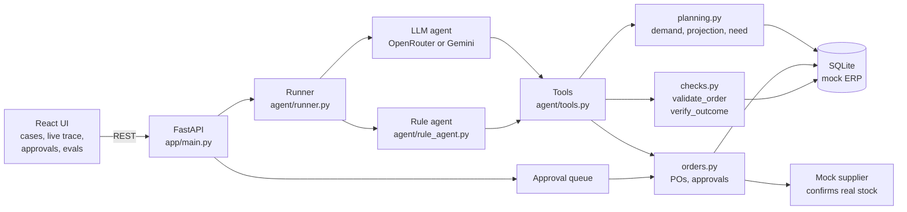
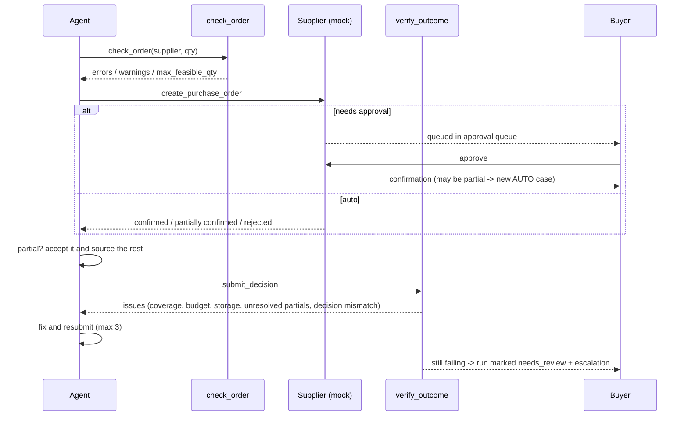

# Architecture

## Feedback loop

## Layers

| Layer | File | Job |
|---|---|---|
| API | `app/main.py` | REST routes for the UI |
| Runner | `app/agent/runner.py` | Starts a run, stores the trace, closes it out |
| Agents | `app/agent/llm_agent.py`, `rule_agent.py` | LLM tool-use loop (OpenRouter / Gemini) / fixed playbook |
| Tools | `app/agent/tools.py` | 15 tools, the only way the agent touches data |
| Maths | `app/planning.py` | Demand estimate, stock projection, requirement |
| Guardrails | `app/checks.py` | Pre-action validation and post-action verification |
| Actions | `app/orders.py` | POs, budget, supplier replies, approval queue |
| Data | `app/db.py`, `mock_data/scenarios.json` | SQLite mock ERP seeded from JSON |
